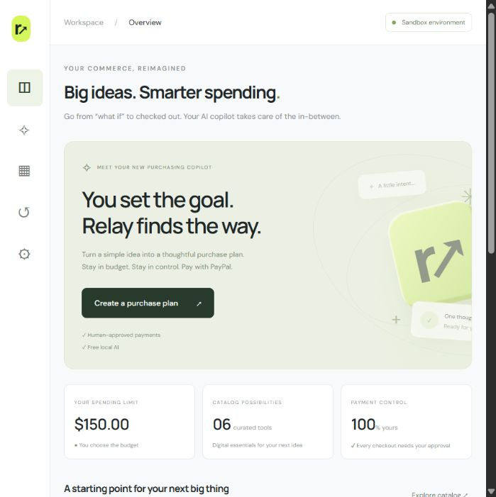

# Relay — AI Purchasing Copilot

**Built solely by Viraj Gundewar** for Build What's Next with PayPal and AI.

Relay turns a shopping goal and a spending limit into a curated digital-product bundle. A local AI model chooses products and explains the tradeoffs; deterministic server checks enforce catalog prices and the budget. The user reviews the plan, approves a PayPal sandbox checkout, and receives a receipt only after a completed capture is verified.



## Inspiration

AI can help people decide what to buy, but spending money needs clear boundaries and human control. Relay started with a question: what if you could describe a goal, set a budget, and let AI assemble a thoughtful purchase plan while keeping payment approval in your hands?

I also wanted to build a working AI commerce prototype without paid AI APIs or hosting. Relay was built as a solo project by Viraj Gundewar.

## What it does

Relay turns a goal into a budget-aware bundle from a curated demo catalog of digital products. Users describe their goal and spending limit, review recommendations and model-generated reasoning, then approve a PayPal sandbox checkout. After a completed capture is verified, Relay displays a receipt and supports JSON export.

The application includes a dashboard, AI planner, product catalog, connection status and transaction history. It clearly distinguishes real Local AI from the keyword-based Simulation mode.

## How we built it

I built Relay solely as **Viraj Gundewar**, using Node.js, HTML, CSS and browser-native JavaScript without npm dependencies. Ollama runs Llama 3.2 locally to interpret goals and recommend products. The server independently validates product IDs, rejects duplicates, calculates catalog prices and enforces budget limits.

PayPal Orders v2 provides sandbox OAuth authentication, order creation, buyer approval and server-side capture. Receipt creation checks completed status, amount and currency. Local JSON storage preserves plans, orders and verified receipts; credentials stay outside version control.

## Challenges we ran into

The main challenge was connecting flexible AI recommendations to precise payment requirements. A model's output cannot be trusted as a payment instruction, so I separated recommendations from deterministic server validation.

I also worked through local model installation and availability, PayPal developer authentication, sandbox buyer setup, and the complete approval-to-capture lifecycle. Clear engine labels and useful errors keep missing integrations from being disguised as successful demonstrations.

## Accomplishments that we're proud of

The full prototype completed an end-to-end test: local AI recommended a **$93 bundle within a $150 budget**, a sandbox buyer approved checkout, PayPal completed the capture, and Relay displayed a verified receipt. Retrying receipt verification returned the same capture without creating a duplicate. Automated budget and catalog tests passed. No real money moved and no paid services were used.

## What we learned

I learned that AI commerce works best when responsibilities are clear: the model recommends, application code enforces constraints, the user approves, and PayPal confirms payment. Local AI can support a useful prototype without paid inference, but installation, hardware requirements and onboarding need attention.

## What's next for Relay — AI Purchasing Copilot

Relay currently runs as a single-user local prototype with a sample catalog. Next, I would add merchant catalog integrations, editable purchase plans, richer user constraints and webhook-based payment reconciliation. The goal is to make purchasing easier while preserving understandable recommendations, enforced budgets and human approval.

## Built with

Node.js · JavaScript · HTML5 · CSS3 · Ollama · Llama 3.2 · PayPal Orders v2 API · PayPal Sandbox · OAuth 2.0

## Run for free

Requires Node.js 22 or later. There are **no npm dependencies, paid AI APIs, or paid hosting services**. Ollama requires a compatible computer, storage, and a model download. Internet is required for PayPal and the optional Google Fonts stylesheet; system fonts work offline.

```powershell
Copy-Item .env.example .env
node --env-file-if-exists=.env server.mjs
```

Open http://localhost:3000. Simulation works immediately and is explicitly labeled keyword matching; it is not AI and is not a completed payment demo.

### Enable real local AI

1. Install [Ollama](https://ollama.com/download).
2. Run `ollama pull llama3.2:3b` and keep Ollama running.
3. Open AI planner and select **Local AI · Ollama**.
4. Enter a brief and budget, then build a plan. The first request may take up to two minutes. Model choices are validated; an invalid or over-budget output produces an error rather than a payable plan. Try again with a clearer brief if that occurs.

The server calls `http://127.0.0.1:11434/api/chat`. Configure `OLLAMA_MODEL` in `.env` if using another installed model. No cloud model or API key is used. See [Ollama API](https://github.com/ollama/ollama/blob/main/docs/api.md).

### Enable PayPal sandbox checkout

1. Create a free [PayPal Developer account](https://developer.paypal.com/dashboard/).
2. In Apps & Credentials, select Sandbox and create a REST application associated with a sandbox business account.
3. Set `PAYPAL_CLIENT_ID` and `PAYPAL_CLIENT_SECRET` in `.env`, then restart the app. Never commit this file.
4. Create or find a separate sandbox **personal buyer account** under Testing Tools → Sandbox Accounts. Use its credentials on PayPal checkout, not your real account.
5. Generate a plan, click **Approve & pay with PayPal**, and approve on PayPal's sandbox site.
6. On return, Relay captures the order and verifies completed status, amount, and USD currency before storing a receipt. View Transactions and export receipts as JSON.

Only `https://api-m.sandbox.paypal.com` is used. There is no live payment mode. The catalog consists of sample digital products, with no real fulfillment. See [PayPal Orders integration](https://developer.paypal.com/api/rest/integration/orders-api).

## What is implemented

- Responsive dashboard, goal templates, AI planner, product catalog, connections and transaction history.
- Real Ollama model integration with clear unavailable/model-loading errors and no disguised AI fallback.
- PayPal OAuth, Orders v2 create, buyer approval redirect, server-side capture and capture verification.
- Server-owned prices, duplicate/unknown item rejection, budget checks, same-origin POST checks and PayPal request idempotency keys.
- Local JSON persistence in ignored `data/store.json`; exported verified receipts.
- Accessible labels, keyboard focus, reduced-motion support and responsive layouts.

## Architecture and limits

`public/` is dependency-free browser code. `server.mjs` serves it and mediates PayPal and Ollama. `core.mjs` contains catalog and budget validation. API routes: GET `/api/config`, GET `/api/receipts`, POST `/api/plan`, POST `/api/orders`, POST `/api/capture`.

This is a **single-user localhost prototype**, not a multi-user commerce deployment. It binds to 127.0.0.1 and intentionally has no authentication, webhook reconciliation, inventory, tax calculation, real product delivery, or production database. Do not expose this server publicly. An interrupted checkout can be retried by revisiting the PayPal return URL; confirmed receipts are idempotent. Sequential checkout retries reuse the same created order. JSON storage is intended for one running process. To reset demo data, stop the server and remove `data/store.json`.

## Verification

```powershell
node --test
```

Tests cover budget validation, unknown and duplicate products, over-budget plans, and simulation budget invariants. A full AI and sandbox transaction requires Ollama plus your sandbox credentials and buyer approval; these are not fabricated by the tests.

### Verified on October 26, 2026

The full flow was exercised on Viraj Gundewar's Windows computer using Ollama 0.40.11 and `llama3.2:3b`: the local model recommended Launch essentials, Growth playbook and Focus workspace for **$93**, under a **$150** limit. PayPal sandbox order creation, US sandbox buyer login and approval, server-side capture, and completed receipt display all succeeded. Capture ID: `46S72922M2000391S`. Repeating the receipt verification returned the same capture and left exactly one receipt. No real money moved. Sandbox API credentials are stored only in the ignored local `.env` file and must not be included in the public repository. A US sandbox test buyer was used with the Indian sandbox merchant to exercise a cross-border test purchase.

Relay's Connections screen checks local model availability. When the configured model is installed and Ollama is running, the planner automatically selects Local AI on page load. See [payment-verified.png](payment-verified.png) for the completed prototype receipt.

## Submission checklist

- Publish this source to a **public** GitHub, GitLab or Bitbucket repository with the included MIT license.
- Include these run instructions so judges can run locally; a hosted demo is optional under the supplied requirements.
- Record the working Local AI → PayPal sandbox → verified receipt flow in a video under three minutes and upload it publicly to YouTube.
- List Node.js, Ollama, the configured model, and PayPal Orders v2 in the submission. Confirm the chosen model's license is suitable for your use.
- Both Local AI and PayPal sandbox need to work for the final submission. Simulation alone is insufficient.

See [DEMO.md](DEMO.md) for a suggested video script and submission description.
